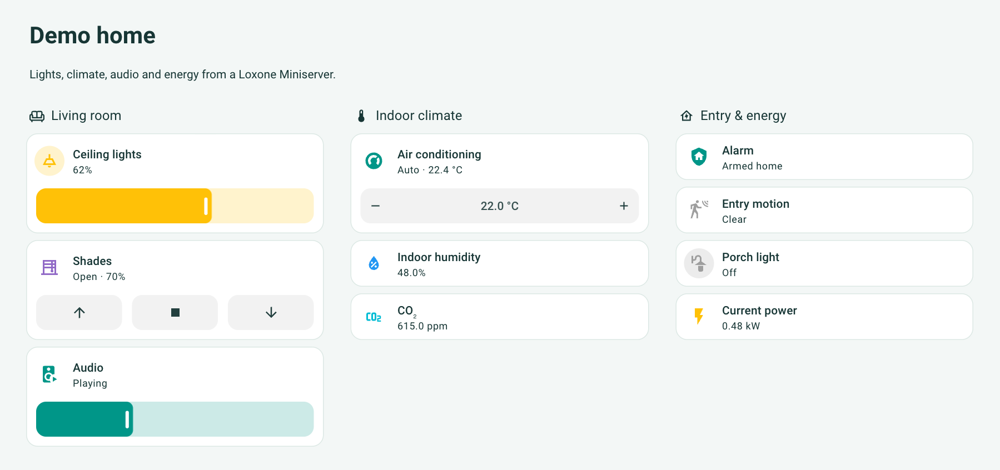
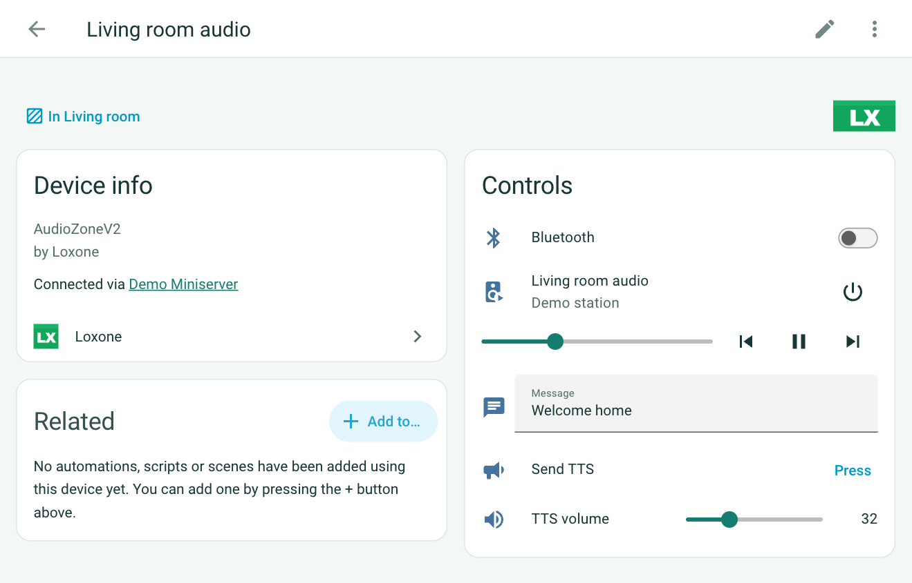

<p align="center">
  <picture>
    <source media="(prefers-color-scheme: dark)" srcset="brand/dark_icon.png">
    
  </picture>
</p>

<h1 align="center">Loxone for Home Assistant</h1>

<p align="center">
  Control your Loxone home from Home Assistant and use Miniserver states and events in your automations.
</p>

<p align="center">
  <a href="https://www.home-assistant.io/"></a>
  <a href="https://hacs.xyz/"></a>
  <a href="https://github.com/ArtifexEt/Loxone-Home-Assistant/actions/workflows/ci.yml"></a>
  <a href="https://github.com/ArtifexEt/Loxone-Home-Assistant/releases"></a>
</p>

<p align="center">
  <a href="#get-started"><strong>Get started</strong></a> ·
  <a href="#see-it-in-home-assistant">See it in Home Assistant</a> ·
  <a href="docs/reference.md">Integration reference</a>
</p>

## See it in Home Assistant

[](docs/screenshots/dashboard.webp)

*Both screenshots come from a demo Home Assistant installation with a simulated Miniserver and fictional data.*

| In your home | In Home Assistant |
| --- | --- |
| **Lighting and comfort** | Adjust lights and moods, move blinds and windows, and set the temperature or ventilation profile. |
| **Entrance** | View the Intercom, react to the doorbell or access events, and see the burglar alarm state. |
| **Audio** | Control playback and volume, browse available sources, and speak a message in a selected Loxone audio zone. |
| **Energy and activity** | Read meter, solar, presence and device status values for dashboards and automations. |

## Get started

1. **Add the repository to HACS.** In HACS, open **Custom repositories** and add [this repository](https://github.com/ArtifexEt/Loxone-Home-Assistant) with the **Integration** category.
2. **Download Loxone and restart Home Assistant.** To pick a prerelease, select **Need a different version?** in the HACS download dialog. [GitHub Releases](https://github.com/ArtifexEt/Loxone-Home-Assistant/releases) · [HACS version selection](https://www.hacs.xyz/docs/use/repositories/dashboard/#downloading-a-specific-version-of-a-repository)
3. **Add the Loxone integration.** Go to **Settings → Devices & services → Add integration → Loxone**. Search the local network or enter the host and port, then sign in with your Miniserver credentials.
4. **Add the entities you need.** Use the devices and entities created by the integration to build your dashboard. Your Loxone project determines which controls and features appear.

<p>
  <a href="https://my.home-assistant.io/redirect/hacs_repository/?owner=ArtifexEt&amp;repository=Loxone-Home-Assistant&amp;category=integration"></a>
  <a href="https://my.home-assistant.io/redirect/config_flow_start/?domain=loxone_home_assistant"></a>
</p>

### Compatibility

| Component | Requirement |
| --- | --- |
| Home Assistant | **2025.1 or later**. |
| Loxone | Miniserver Gen 1, Gen 2, Go or Compact with firmware **10.2 or later**. |
| Connection | Local discovery or manual host and port. Gen 1 requires a firmware-provided Loxone-signed certificate chain for command encryption. Manual setup also supports Remote Connect. |

For custom ports, TLS verification, Remote Connect and Loxone 17.3 media authentication, see [compatibility and connection](docs/reference.md#compatibility-and-connection).

## Intercom Gen 2

A locally paired Intercom Gen 2 can expose a **Live** camera with two-way audio and a doorbell history gallery. [Intercom Gen 2 support](https://github.com/ArtifexEt/Loxone-Home-Assistant/pull/4) · [First prerelease with these features](https://github.com/ArtifexEt/Loxone-Home-Assistant/releases/tag/v0.1.1b31)

- **Live video and talk.** Use Home Assistant **2026.11 or later** with a locally paired Intercom Gen 2 and an HTTPS Miniserver connection. Enable **Two-way audio** in Home Assistant Labs and open Home Assistant over HTTPS to use the microphone in a browser. [Home Assistant camera guide](https://www.home-assistant.io/integrations/camera/#talking-through-a-camera)
- **Doorbell photos.** Choose **Visit** on the Intercom device to open its history gallery. Use **History photo** to select a snapshot for the **Photo preview** camera. [Intercom media and permissions](docs/reference.md#intercom-media)
- **Dashboard.** Replace the example entity IDs with your own and register the gallery module to use the history view. [Example dashboard](examples/intercom-dashboard.yaml) · [Gallery setup](docs/reference.md#photo-history-and-dashboard)

## Send a spoken announcement

On the audio zone's device page, enter your message, set **TTS volume** and press **Send TTS**.

[](docs/screenshots/integration.webp)

To send an announcement from an automation, use the action below and replace the example entity ID with yours.

```yaml
action: media_player.play_media
target:
  entity_id: media_player.example_living_room_audio
data:
  media_content_type: tts
  media_content_id: "Dinner is ready."
```

Audio Player speech synthesis requires internet access. Setup and examples for audio helpers, volume and the original Music Server's event playback are in the audio reference. [Loxone Audio Player](https://www.loxone.com/enen/kb/audio-player/) · [Audio and announcements](docs/reference.md#audio-and-announcements)

## For integrators

| Topic | Reference |
| --- | --- |
| **What is imported** | [LoxAPP3 sections, supported controls and diagnostic entities](docs/reference.md#entity-mapping) |
| **Commands and services** | [Control UUIDs, raw commands, TTS and Intercom actions](docs/reference.md#home-assistant-actions) |
| **Automation triggers** | [Doorbell and access event payloads](docs/reference.md#automation-events) |
| **Maintenance** | [Troubleshooting and debug logs](docs/reference.md#troubleshooting) · [Tests and development](docs/reference.md#development) |

Home Assistant reads the Miniserver's project structure and receives status updates over WebSocket. The integration checks for project changes after reconnecting and periodically while online.

## Help and support

[Open an issue](https://github.com/ArtifexEt/Loxone-Home-Assistant/issues/new/choose) with your Home Assistant version, Miniserver model and firmware, and the affected Loxone block type. Remove credentials, serials and private addresses from logs or screenshots before sharing them.

[](https://buymeacoffee.com/szymonrybka)
